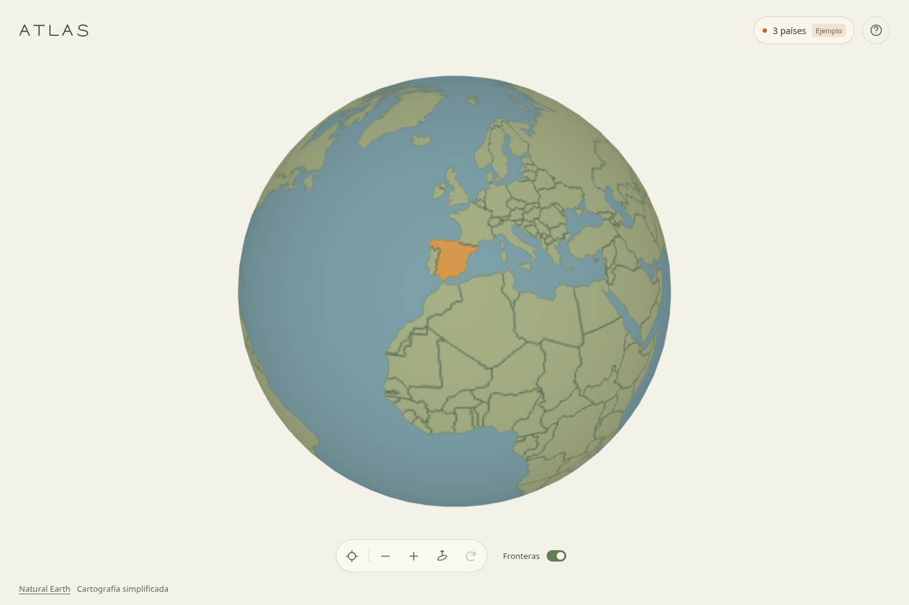

# ATLAS

Un atlas personal para recorrer, en un globo terráqueo 3D, los lugares que has
visitado. El proyecto se construye por fases a partir de exportaciones de Google
Maps Timeline, con el tratamiento de datos en tu propio ordenador.

El globo es la escena principal de ATLAS. La interfaz nativa en TypeScript y CSS
agrupa los controles alrededor de una Tierra dibujada con WebGL 2. La cartografía
usa colores planos y fronteras simplificadas de Natural Earth.

**Modo de ejemplo:** España (`ESP`), México (`MEX`) y Japón (`JPN`) son tres
países ficticios de demostración. La importación de Timeline y el tratamiento
del historial personal siguen pendientes de las fases de datos.

La hoja de ruta y las instrucciones de desarrollo están en [PLAN.md](PLAN.md)
y [AGENTS.md](AGENTS.md).



[Vista móvil](docs/images/globo-atlas-movil.png).

## Arrancar en local

Necesitas **Node.js 24 LTS**, **npm 11** y Git.

```sh
git clone https://github.com/alfonsodfernandez/atlas.git
cd atlas
npm ci
npm run dev
```

Abre [http://localhost:5173/atlas/](http://localhost:5173/atlas/). No necesitas
cuentas de mapas, claves API ni datos de Timeline.

```sh
npm run check       # privacidad, formato, lint, tipos y pruebas unitarias
npm run build       # build estático y comprobación del presupuesto de descarga
npm run preview     # servir apps/web/dist/
npm run check:bundle # volver a comprobar el tamaño del build
```

Las pruebas de navegador usan Chromium:

```sh
npx playwright install chromium
npm run test:e2e
```

GitHub Actions comprueba cada push y pull request. Los resultados del hito se
registran en [PLAN.md](PLAN.md); las medidas de rendimiento conservan su método
y revisión de origen en [docs/performance/](docs/performance/).

## Explorar el globo

Arrastra para girar la Tierra y usa la rueda o los controles de zoom para
acercarte. En móvil puedes usar los gestos táctiles. Los controles permiten
volver a la vista inicial, cambiar la inclinación y activar o desactivar las
fronteras.

La cabecera identifica el modo **«3 países · Ejemplo»**. En el panel de ejemplo,
los botones **Ver España**, **Ver México** y **Ver Japón** centran la cámara en
cada país. **Mostrar ejemplo** activa o desactiva los colores de esta
demostración. Ese control no importa ni modifica un historial personal.

Puedes enfocar el globo con Tab: las flechas mueven la cámara, `+` y `−` controlan
el zoom, y `Home` recupera la vista inicial. La rotación lenta se detiene al
interactuar y respeta `prefers-reduced-motion`. Desde **Ayuda** se accede a las
instrucciones, la privacidad y la alternativa accesible. Si WebGL no está
disponible, la información y el reintento siguen siendo accesibles.

La primera vista carga una máscara local de 1024 × 512 píxeles derivada de
Natural Earth 1:110m (18.277 bytes). Al acercarte, el visor puede cargar una
máscara adicional de 2048 × 1024 procedente de la fuente 1:50m (51.920 bytes)
para definir mejor costas y límites.
Los polígonos se procesan al generar los recursos; el navegador utiliza los PNG.
[Procedencia, licencia y generación](docs/cartografia.md).

Estas máscaras son para visualización. No prometen precisión topológica ni
sirven para decidir el país de una visita junto a una frontera o en el mar.
Las 177 y 242 entidades de las fuentes cartográficas son distintas de los tres
países ficticios del ejemplo.

## Rendimiento

El globo mantiene una pasada WebGL por fotograma y reutiliza la geometría y los
recursos de GPU. Las máscaras de tierra, fronteras y ejemplo se generan de
antemano. La carga inicial utiliza el recurso ligero; el detalle adicional se
solicita al hacer zoom, en lugar de precargarlo para la primera vista.

La escena se dibuja cuando cambia o mientras está activa la rotación. La
animación se pausa cuando el visor no está visible y se respetan las preferencias
de movimiento reducido. Los controles y paneles usan el DOM nativo.

La primera vista descarga unos **33 KB** de recursos según la estimación de
compilación. `npm run build` comprueba los límites de 40 KiB de JavaScript
bruto, 15 KiB de JavaScript con gzip, 44 KiB de carga inicial y 64 KiB para
el mapa de detalle. [Mediciones y método](docs/performance/).

## Privacidad

**Las exportaciones crudas nunca deben subirse al repositorio, a un chat ni a un
servidor.** El historial puede revelar tu casa, tu trabajo y tus rutinas. Guarda
los originales únicamente en tu equipo, dentro de `data/raw/`, que Git ignora.

Desde el primer commit se ignoran también `Timeline.json`, `*.Timeline.json`,
`location-history.json`, `Records.json`, las carpetas `Semantic Location History/`
y `Takeout/`, los ZIP de `data/`, el archivo local `atlas.config.json` y las
variables de entorno privadas.

Husky instala un hook de pre-commit al ejecutar `npm ci`. Comprueba los blobs
preparados en el índice de Git; CI vuelve a comprobar el árbol del repositorio.
Los controles buscan nombres de exportación y firmas del formato crudo, y
bloquean el commit si los detectan. Puedes ejecutarlos con
`npm run check:privacy`. Mantén los archivos ignorados fuera del índice y el
hook activo.

Estas barreras evitan errores comunes, pero **no convierten cualquier JSON en
datos publicables**. El pipeline de saneado aún no está implementado. Todo lo
que contenga `public/` formará parte del build publicado.

El contrato previsto para la Fase 2 es publicar únicamente
`public/data/atlas.json`, validado y agregado:

- Precisión de ciudad por defecto; la ubicación exacta de un lugar requerirá
  marcarlo como público de forma explícita.
- Zonas de exclusión para casa, trabajo y otros lugares privados.
- Fechas sin horas exactas, con opción de conservar solo mes o año.
- Sin trazas GPS detalladas junto a zonas excluidas.
- Avisos locales sobre posibles ubicaciones de casa y trabajo y un informe de
  lo que se publicaría antes de guardar el resultado.

## Cargar tus datos

**Pendiente de las Fases 2 y 5.** Por ahora no existe el comando `ingest` ni un
formulario de importación. El flujo previsto será:

1. Exportar Timeline desde Android, iOS o Takeout con las instrucciones que se
   verificarán al implementar los parsers.
2. Guardar el JSON o ZIP en `data/raw/` en tu ordenador.
3. Copiar `atlas.config.example.json` a `atlas.config.json` y definir las zonas
   que quieres excluir. El ejemplo todavía es provisional.
4. Ejecutar la futura CLI `npm run ingest -- data/raw/Timeline.json` en local y
   revisar su informe de privacidad.
5. Revisar y versionar únicamente el `public/data/atlas.json` saneado.

La alternativa de la Fase 5 procesará JSON o ZIP en un Web Worker del navegador
y permitirá descargar el resultado saneado con procesamiento local. El
desarrollo utilizará exclusivamente muestras sintéticas identificadas como tales.

## Estructura

```text
apps/web/                 Interfaz TypeScript/CSS y motor WebGL propio
packages/timeline-parser/ Lógica futura para CLI y Web Worker
packages/geo/             Base para geocodificación offline
scripts/                  Calidad, generación de mapas y mediciones
data/sample/              Futuro dataset sintético
data/raw/                 Exportaciones locales, ignoradas por Git
public/data/              Futura salida agregada y saneada
public/maps/              Máscaras cartográficas inicial y de detalle local
docs/performance/         Informes de tamaño y arranque
.github/workflows/        CI y publicación
```

Para generar o comprobar la máscara cartográfica:

```sh
node scripts/prepare-map.mjs
node scripts/prepare-map.mjs --check
```

El generador prepara `public/maps/atlas-map.png` y
`public/maps/atlas-map-detail.png`. Los polígonos fuente se guardan bajo
`scripts/geo/` y quedan fuera del sitio publicado. La generación utiliza las
fuentes locales fijadas y no necesita descargarlas de nuevo.

## Desplegar

El destino es **GitHub Pages**. `.github/workflows/deploy.yml` publica la revisión
actual de `main` tras una CI correcta y también admite ejecución manual desde
`main`. Comprueba calidad y privacidad, prepara el build y sube únicamente
`apps/web/dist/`. La base local es `/atlas/`; la publicación utiliza la base
proporcionada por Pages.

La fuente de Pages debe ser **Settings → Pages → Build and deployment → Source:
GitHub Actions**. El usuario ya ha mostrado esa selección guardada. El estado
del despliegue y la URL pública se verifican por separado; consulta el registro
actual en [PLAN.md](PLAN.md). Para ejecutar la publicación, abre
[Publicar en GitHub Pages](https://github.com/alfonsodfernandez/atlas/actions/workflows/deploy.yml),
pulsa **Run workflow**, elige **main** y espera a que `build` y `deploy` terminen
en verde. El build nativo no requiere secrets de mapas.

Para un **dominio propio**, añade `public/CNAME` con tu dominio y compila con
`ATLAS_BASE_PATH=/ npm run build`. Configura los DNS según GitHub Pages y
comprueba HTTPS antes de compartir el enlace.

Para un **VPS con Nginx**, ejecuta `npm ci && npm run build` y copia el contenido
de `apps/web/dist/` al directorio servido. Con la base actual:

```nginx
server {
    listen 80;
    server_name atlas.example.com;
    root /var/www/html;

    location /atlas/ {
        try_files $uri $uri/ /atlas/index.html;
    }
}
```

Para servir en la raíz del dominio, compila con base `/` y adapta la ruta de
Nginx. Publica únicamente el build estático.

## Próximo hito

Tras validar esta reescritura y su publicación, la Fase 2 investigará los formatos
actuales de Timeline y construirá el pipeline de datos sintéticos, geocodificación
offline y saneado. Explorar el globo actual no requiere exportar tu historial.
