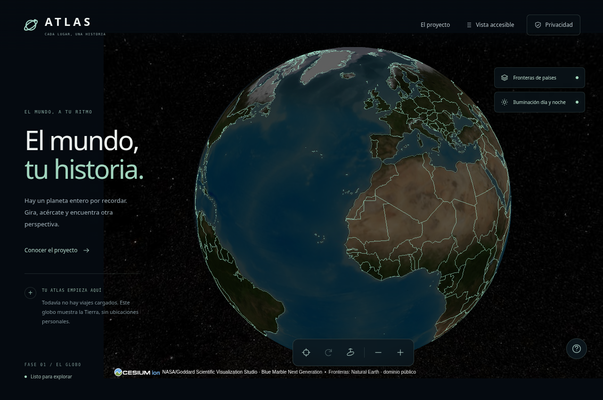

# ATLAS

Un atlas personal para recorrer, en un globo terráqueo 3D, los lugares que has
visitado. El proyecto se construye por fases a partir de exportaciones de Google
Maps Timeline, con el tratamiento de datos en tu propio ordenador.

**Estado: Fase 1 — globo; publicación pendiente de verificar.** La Fase 0 está
integrada y este hito incorpora un globo Cesium WGS84 con controles, atmósfera,
iluminación día/noche y una capa de países. La vista básica usa mapas locales y
funciona sin claves API. Todavía no contiene historial, visitas ni estadísticas
personales: la importación y el saneado llegan en la Fase 2.

La hoja de ruta completa está en [PLAN.md](PLAN.md); las instrucciones técnicas
para continuar el desarrollo, en [AGENTS.md](AGENTS.md).



## Arrancar en local

Necesitas **Node.js 24 LTS**, **npm 11** y Git.

```sh
git clone https://github.com/alfonsodfernandez/atlas.git
cd atlas
npm ci
npm run dev
```

Abre [http://localhost:5173/atlas/](http://localhost:5173/atlas/). No necesitas
cuentas de mapas, claves API ni datos de Timeline para esta fase.

```sh
npm run check       # privacidad, formato, lint, tipos y pruebas unitarias
npm run build       # aplicación estática en apps/web/dist/
npm run preview     # previsualizar el build
```

Las pruebas de navegador usan Chromium:

```sh
npx playwright install chromium
npm run test:e2e
```

GitHub Actions ejecuta privacidad, formato, lint, tipos, pruebas y build en cada
push y pull request. Los E2E de esta fase comprueban el globo y sus controles en
el navegador; los resultados de validación se registran en [PLAN.md](PLAN.md).

## Explorar el globo

Arrastra para girar la Tierra y usa la rueda o los controles de zoom para
acercarte. En móvil puedes usar los gestos táctiles. La interfaz permite volver
a la vista inicial, inclinar la cámara y activar o desactivar las fronteras y la
iluminación día/noche.

El área del globo también se puede enfocar con Tab: las flechas mueven la cámara,
`+` y `−` controlan el zoom, y `Home` recupera la vista inicial. La rotación lenta
se detiene al interactuar y se desactiva si el sistema solicita movimiento
reducido. Si WebGL no está disponible, la aplicación muestra una alternativa
accesible con información y una opción para reintentar.

La imagen de la Tierra de NASA y la capa Natural Earth Admin 0, escala 1:50m,
se sirven desde `public/maps/`, con atribuciones visibles. La vista básica no
consulta servidores de mapas y representa un **elipsoide WGS84 sin relieve**;
no simula edificios ni terreno que no estén disponibles.

La [procedencia y las licencias de la cartografía](public/maps/README.md)
incluyen versiones y hashes. Las 242 entidades de Natural Earth incluyen
territorios y áreas disputadas; no equivalen a países reconocidos ni visitados.

### Terreno y edificios opcionales

Copia `.env.example` a `.env.local` en la raíz, añade las claves que quieras usar
y reinicia Vite:

- `VITE_CESIUM_ION_TOKEN`: terreno mundial e imágenes Bing mediante Cesium ion.
- `VITE_GOOGLE_MAPS_API_KEY`: Google Photorealistic 3D Tiles; requiere acceso a
  la API correspondiente y la facturación que establezca Google.

Sin claves, o si el proveedor falla, se conserva el globo básico local. Los modos
opcionales solicitan recursos a sus proveedores y pueden transmitir la zona del
mapa que estás mirando. No contienen ni reciben datos de Timeline en esta fase.
Las variables de Vite son visibles en el navegador: restringe las claves al
dominio y a las APIs necesarias.

## Privacidad

**Las exportaciones crudas nunca deben subirse al repositorio, a un chat ni a un
servidor.** El historial puede revelar tu casa, tu trabajo y tus rutinas. Guarda
los originales únicamente en tu equipo, dentro de `data/raw/`, que Git ignora.

Desde el primer commit se ignoran también `Timeline.json`, `*.Timeline.json`,
`location-history.json`, `Records.json`, las carpetas `Semantic Location History/`
y `Takeout/`, los ZIP de `data/`, el archivo local `atlas.config.json` y las
variables de entorno privadas.

Husky instala un hook de pre-commit al ejecutar `npm ci`. Este comprueba el
contenido preparado en el índice de Git; CI vuelve a comprobar el árbol del
repositorio. Los controles buscan nombres de exportación y firmas del formato
crudo, y bloquean el commit si los detectan. Puedes ejecutarlos con
`npm run check:privacy`. No fuerces la inclusión de archivos ignorados ni
desactives el hook.

Estas barreras evitan errores comunes, pero **no convierten cualquier JSON en
datos publicables**. El pipeline de saneado aún no está implementado. No añadas
historial real a `public/`: todo lo que contenga esa carpeta formará parte del
build público.

Los mapas básicos se sirven con la aplicación. Activar terreno o edificios
opcionales implica contactar con Cesium o Google para cargar mapas; esto es
distinto del futuro procesamiento local del historial. Los archivos originales
de Timeline deberán permanecer siempre en el ordenador del usuario.

El contrato previsto para la Fase 2 es publicar únicamente
`public/data/atlas.json`, validado y agregado:

- Precisión de ciudad por defecto; una ubicación exacta requerirá marcar ese
  lugar como público de forma explícita.
- Zonas de exclusión para casa, trabajo y otros lugares privados. Se eliminarán
  o reducirán a municipio según la configuración elegida.
- Fechas sin horas exactas, con opción de conservar solo mes o año.
- Sin trazas GPS detalladas junto a zonas excluidas.
- Avisos locales sobre posibles ubicaciones de casa y trabajo y un informe de lo
  que se publicaría antes de guardar el resultado.

## Cargar tus datos

**Pendiente de las Fases 2 y 5.** Por ahora no existe el comando `ingest` ni un
formulario de importación. No hace falta exportar tu historial para arrancar la
aplicación.

El flujo previsto será:

1. Exportar Timeline desde Android, iOS o Google Takeout, siguiendo las
   instrucciones que se verificarán y documentarán al implementar los parsers.
2. Guardar el JSON o ZIP en `data/raw/` en tu ordenador.
3. Copiar `atlas.config.example.json` a `atlas.config.json` y definir las zonas
   que quieres excluir. El ejemplo actual es una propuesta de configuración y
   todavía no se aplica ni se valida.
4. Ejecutar la futura CLI local `npm run ingest -- data/raw/Timeline.json` y
   revisar su informe de privacidad.
5. Revisar y versionar únicamente el `public/data/atlas.json` saneado.

La alternativa prevista para la Fase 5 procesará JSON o ZIP en un Web Worker del
navegador y permitirá descargar el resultado saneado sin enviar el archivo a un
servidor. El desarrollo usará exclusivamente muestras sintéticas identificadas
como tales; nunca se presentarán como el historial de Alfonso.

## Estructura

```text
apps/web/                 Aplicación React + Vite + TypeScript
packages/timeline-parser/ Lógica compartida para CLI y futuro Web Worker
packages/geo/             Base para geocodificación offline
scripts/                  Comprobaciones y futura CLI
data/sample/              Documentación del futuro dataset sintético
data/raw/                 Exportaciones locales, ignoradas por Git
public/data/              Futura salida agregada y saneada
public/maps/              Imagen terrestre y países, con fuentes y atribuciones
.github/workflows/        Integración continua
```

## Desplegar

El destino elegido es **GitHub Pages**. `.github/workflows/deploy.yml` prepara
el build y la publicación después de una CI correcta en `main`; también admite
ejecución manual desde `main`. Vuelve a comprobar privacidad, formato, lint,
tipos y pruebas unitarias antes de publicar y usa las acciones oficiales de
Pages. La CI previa en `main` incluye los E2E. La base local es `/atlas/`; el
workflow emplea la base que devuelve GitHub al configurar el despliegue.

**La activación de Pages y la URL pública siguen pendientes de verificar.** La
conexión de desarrollo recibe HTTP 403 al consultar la configuración de Pages.
En GitHub, selecciona **Settings → Pages → Build and deployment → Source:
GitHub Actions** si esa opción está disponible y ejecuta el workflow de
publicación. El repositorio es privado: la disponibilidad de Pages depende del
plan y de las políticas de la cuenta. No se cambia su visibilidad automáticamente.

Para los mapas opcionales publicados, configura los secrets de Actions
`CESIUM_ION_TOKEN` y/o `GOOGLE_MAPS_API_KEY`. El workflow los asigna a
`VITE_CESIUM_ION_TOKEN` y `VITE_GOOGLE_MAPS_API_KEY` durante el build. Déjalos
sin definir para publicar la vista básica sin claves.

Para un **dominio propio o subdominio**, compila con
`ATLAS_BASE_PATH=/ npm run build`, añade `public/CNAME` con tu dominio antes del
build y configura los registros DNS
según GitHub Pages. Comprueba HTTPS antes de compartir el enlace.

Para un **VPS con Nginx**, ejecuta `npm ci && npm run build` y copia el contenido
de `apps/web/dist/` al directorio que sirva Nginx. Con la base actual, el build
debe servirse bajo `/atlas/`, por ejemplo desde `/var/www/html/atlas/`:

```nginx
server {
    listen 80;
    server_name atlas.example.com;
    root /var/www/html;

    location /atlas/ {
        try_files $uri $uri/ /atlas/index.html;
    }
}
```

Adapta el dominio y habilita TLS en tu servidor. Para servir en la raíz del
dominio, cambia la base a `/`, recompila y ajusta el directorio y la ruta de
Nginx. Sube únicamente el build; no copies el repositorio completo ni `data/raw/`.

## Próximo hito

Tras verificar el globo y su publicación, la Fase 2 investigará los formatos
actuales de Timeline antes de escribir los parsers. Incorporará datos sintéticos,
geocodificación offline y el pipeline que genere un `atlas.json` saneado. No es
necesario exportar el historial para explorar esta versión.
